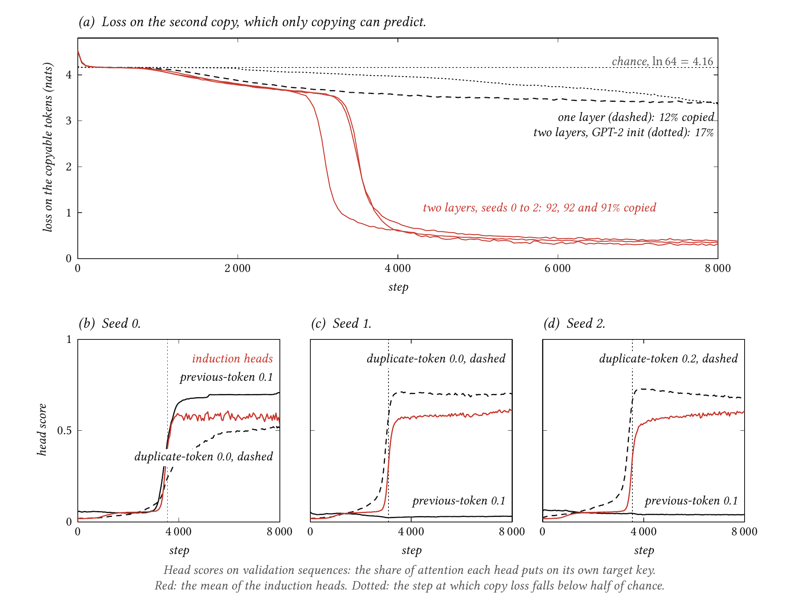
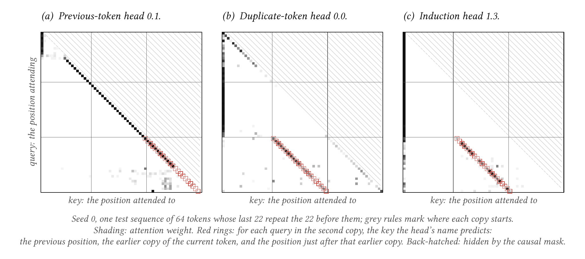
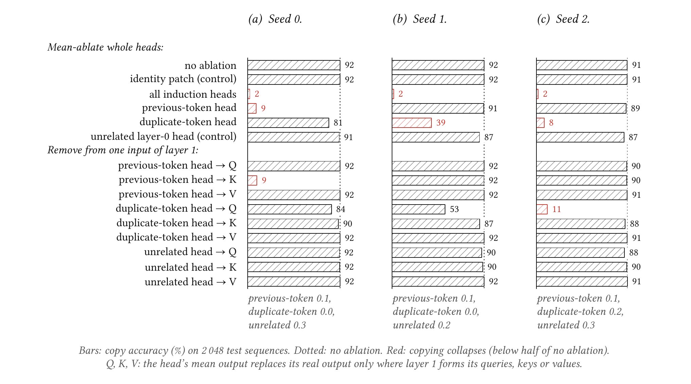
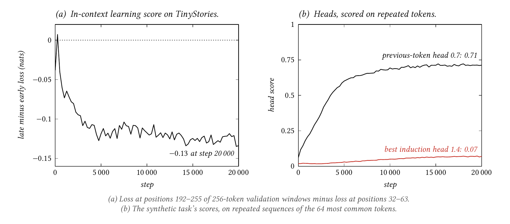

# deja-vu-tfm

**Induction heads.** Watching in-context copying appear as a phase change in a 2-layer attention-only transformer, and finding the heads responsible.

**Status:** done for the synthetic task; the text half is a negative result (see below).

## Question

Can we watch in-context copying appear as a sudden phase change, and find the exact heads responsible?

## Results

**Copying appears suddenly, and the heads that do it appear at the same moment.** A 2-layer attention-only tiny-transformer (46k parameters) trains on random tokens in which one segment repeats. For about 3,000 steps the loss on the repeated half creeps down slowly. Then, within roughly 500 steps, it falls from 3.6 to under 1 nat. In each of three seeds, four layer-1 heads become induction heads at that same step: from each token of the second copy they attend to the token that followed its earlier copy. A one-layer model trained the same way never makes the jump.



*__The copy loss collapses at step 3,100 to 3,550, at the moment the induction heads form; a one-layer model never gets there.__ Runs `default-seed0` to `default-seed2`, `one-layer-seed0` and `gpt2-init-seed0`, evaluated every 50 steps on 512 held-out sequences. (a) Loss on the copyable tokens. Chance is ln 64 = 4.16 nats, since each token is one of 64. (b–d) Each seed's head scores: the share of attention a head puts on its own target key. The induction heads (red, mean of the four) rise in step with the layer-0 head that feeds them. That head is a previous-token head in seed 0 (solid) and a duplicate-token head in seeds 1 and 2 (dashed).*

| Model (test set, 2,048 sequences) | Copy loss (nats) | Copy accuracy | Loss on fresh tokens |
| --- | --- | --- | --- |
| Untrained, same architecture (seeds 0–2) | 4.49–4.53 | 1.4–1.6% | 4.51–4.52 |
| One layer: `--model.n-layers 1` (seed 0) | 3.40 | 11.8% | 4.20 |
| Two layers, GPT-2 init: `--model.init gpt2` (seed 0) | 3.34 | 16.6% | 4.19 |
| Two layers, seed 0 | 0.31 | 92.2% | 4.22 |
| Two layers, seed 1 | 0.34 | 91.8% | 4.20 |
| Two layers, seed 2 | 0.38 | 90.5% | 4.21 |

Copy accuracy is the share of copyable tokens (r₂ … r_L of the second copy) the model ranks first. Chance is 1/64 (1.6%). Fresh tokens can't be predicted by anything, so ln 64 = 4.16 nats is the best possible loss on them. The trained models sit 0.04–0.06 nats above it: they spend a little confidence copying chance repeats in the random filler.



*__The three kinds of head do exactly what their names say.__ Run `default-seed0`, heads 0.1, 0.0 and 1.3, on the first test sequence: 64 tokens whose last 22 repeat the 22 before them. Rows are queries, columns keys, and shading is the attention weight. The red rings mark, for each query in the second copy, the key the head is named for. The previous-token head attends one step back almost everywhere. The duplicate-token head finds the earlier copy of the current token. The induction head attends one step past that copy, to the token that comes next.*

**Every seed builds induction heads, but not every seed feeds them the same way.** The textbook circuit (Elhage et al. 2021) is K-composition. A layer-0 previous-token head writes "the token before me was x" into each position. A layer-1 head's query ("I am x") then matches the key of the position right after x's earlier copy. Seed 0 does this. Seeds 1 and 2 instead use Q-composition. A layer-0 duplicate-token head copies the *position* of the current token's earlier copy into the query, and the layer-1 head attends to the position one step later. The earlier copy holds nothing else the query doesn't already have, since it is the same token. The two routes end in the same induction attention.

Path ablation tells them apart. It removes a layer-0 head from just one of layer 1's three inputs (queries, keys or values), leaving the other two and the direct path to the logits intact.



*__Seed 0 needs its previous-token head in layer 1's keys; seeds 1 and 2 need their duplicate-token head in layer 1's queries.__ Runs `default-seed0` to `default-seed2`, 2,048 test sequences, head means taken from validation. Ablating all four induction heads leaves 2% copy accuracy in every seed. Removing the critical layer-0 head from the input it feeds does as much damage as removing the head entirely. Removing it from the other two inputs, or removing an unrelated layer-0 head from any input, costs at most 5 points. The identity patch, the control that must change nothing, changes nothing.*

| Test set, copy accuracy | Seed 0 | Seed 1 | Seed 2 |
| --- | --- | --- | --- |
| No ablation | 92.2% | 91.8% | 90.5% |
| All four induction heads ablated | 2.3% | 1.7% | 1.7% |
| Best single induction head ablated | 80.6% | 86.5% | 80.4% |
| Previous-token head 0.1 ablated | **8.6%** | 91.3% | 89.4% |
| Duplicate-token head ablated (0.0, 0.0, 0.2) | 81.0% | **39.3%** | **7.7%** |
| Unrelated layer-0 head ablated (0.3, 0.2, 0.3) | 91.4% | 87.3% | 87.2% |
| Previous-token head removed from layer 1's keys only | **9.3%** | 91.6% | 90.0% |
| Duplicate-token head removed from layer 1's queries only | 83.6% | **52.9%** | **10.9%** |
| Loss on fresh tokens, all induction heads ablated | 4.17 | 4.17 | 4.17 |

The four induction heads back each other up: ablating the best one alone costs only 5–12 points. The general loss (on fresh tokens) does not suffer when the circuit goes. It improves slightly, to ln 64, because the model stops copying chance repeats. In seed 1 two duplicate-token heads (0.0 and 0.3, scores 0.70 and 0.61) share the work, so removing one costs about half the copying.

The weights say the same thing. Composition scores (Elhage et al. 2021) measure how much of what a layer-0 head writes a layer-1 head reads. Each duplicate-token head scores 0.21–0.26 for Q-composition with every induction head. Seed 0's previous-token head scores 0.19 for K-composition. The untrained model averages 0.12–0.13.

**Negative result: with tiny-transformer's GPT-2 initialisation, no induction heads formed.** tiny-transformer initialises every weight and embedding with standard deviation 0.02, as GPT-2 does. With that init:
- **The documented run.** `gpt2-init-seed0` is the default recipe with only the init changed. It copies 16.6% of tokens after 8,000 steps, and its best layer-1 induction score is 0.01.
- **The exploratory runs.** Before finding this I tried about 15 other GPT-2-init settings, none kept as figures: sequences of 32 to 128 tokens, 64 to 512 distinct tokens, learning rates 1e-3 to 3e-3, batches of 64 to 512, up to 20,000 steps, with and without LayerNorm, and sinusoidal starting positions (two runs, stopped at 3,000 steps). None formed an induction head; the best layer-1 induction score in any of them was 0.06. Several still learned to copy, up to 99.6%, through other routes that I did not reverse-engineer: layer-0 heads that spread attention around the earlier copy, read out through layer 1's values.
- **The fix.** Switching to PyTorch's default initialisation, as the small induction-head replications use, is what made the circuit appear. Embeddings then start at standard deviation 1 rather than 0.02. LayerNorm was not the cause: with PyTorch's init and LayerNorm on, an exploratory run also formed induction heads, at step 5,300.

Why init scale matters so much is not established here. One plausible reading: with tiny embeddings, every head starts with near-uniform attention, so a sharp previous-token or duplicate-token head gets little gradient, and a diffuse alternative wins first. This matters for blindfold-tfm and tiny-trace-tfm, which build on the same backbone.

**Negative result: on TinyStories, no induction head formed in 330M tokens.** The same 2-layer attention-only design, with d_model 256 and 8 heads (4.8M parameters), trained for 20,000 steps of 64 windows of 256 tokens. It used PyTorch's init and no LayerNorm. The previous-token head forms early, as it should on text, where knowing the previous token helps by itself. On uniformly random tokens it doesn't, which is why the synthetic seeds often build the duplicate-token route instead. The best induction head reaches a score of only 0.07. It copies 1.7% of repeated common-token sequences, about what guessing among those 64 tokens would give, and the in-context learning score levels off at −0.13 nats.



*__On text the previous-token head forms within a few thousand steps, but the induction head does not follow within 20,000.__ Run `stories-seed0`. (a) The in-context learning score: loss late in a window minus loss early, negative when context helps (Olsson et al. 2022). (b) Head 0.7 becomes a previous-token head (0.71). The best layer-1 induction score creeps from 0.02 to 0.07.*

The faint induction attention that exists is already built the textbook way. Removing previous-token head 0.7 from layer 1's keys alone drops head 1.4's induction score from 0.07 to 0.02; its queries and values don't matter. On the test text the model reaches 2.24 nats (the untrained model 9.33). Ablating head 0.7 costs 0.26 nats, and ablating head 1.4 costs 0.11.

Olsson et al. see the phase change after billions of tokens, about ten times this run. An earlier exploratory run with GPT-2's init and LayerNorm went 18,500 steps (300M tokens) with an induction score of 0.03 and an ICL score of about −0.14. Whether longer training gets there is the obvious next experiment.

## How it works

The owner knows the transformer from tiny-transformer. This is what is new here.

- **Induction heads.** To continue `… Harry Potter … Harry` with `Potter`, a model has to find the earlier `Harry` and copy whatever came next. One attention head cannot do that alone: a key at position k knows its own token, not the token before it. So a two-step circuit forms. A layer-0 head first moves information between positions. A layer-1 head then attends, from the current token, to the position just after that token's earlier occurrence, and copies its token into the prediction. That layer-1 head is an induction head.
- **Composition.** Layer 1 reads the residual stream three times: for its queries, its keys and its values. A layer-0 head's output can feed any of them, which is called Q-, K- or V-composition.
  - **K-composition.** A previous-token head writes "the token before me was x" into every key. The induction head's query "I am x" then matches the right key directly.
  - **Q-composition.** A duplicate-token head finds the earlier copy of x and writes its position into the query. The induction head then looks one position further along.
- **Head scores.** On a sequence with period L, a query at position q in the second copy holds the same token as position q − L. A head's previous-token, duplicate-token and induction scores are its average attention on keys q − 1, q − L and q − L + 1. Chance is the score of a head that spreads its attention evenly, 6% and 2% here.
- **Mean ablation.** Replace a head's output with its average over validation sequences. The head still adds its typical offset, but no information about this sequence.
- **Path ablation.** Mean-ablate a layer-0 head only where layer 1 forms its queries, or keys, or values. Layer 1's attention is recomputed from the edited stream and patched in, using tiny-transformer's `patch` hooks. With nothing ablated the recomputation reproduces the model exactly, and a test checks that.
- **Composition scores.** From the weights alone, ‖A·B‖ / (‖A‖‖B‖), where B is what a layer-0 head writes and A is the layer-1 circuit that reads it (Elhage et al. 2021). Random matrices score well above zero, so the untrained model is the baseline.
- **Why the period varies.** If every repeat had the same length L, one head could copy by attending exactly L − 1 positions back. That needs position alone, no induction. A small replication reports exactly this shortcut. Here L is drawn per sequence, from 8 to 28, so only content can find the earlier copy.

## Experiment

**Synthetic.** Each sequence is 64 tokens: BOS, random filler, then a random segment of length L repeated once, ending at the last position. Every token is uniform over 64 ids.
- **Splits.** The split unit is the repeated segment. 512 validation and 2,048 test sequences are fixed by their own seeds. Training draws fresh sequences every step and redraws any whose segment is held out, so each sequence and its own copy are always in the same split.
- **Metrics.**
  - **Copy loss and accuracy** on r₂ … r_L of the second copy, the only predictable targets. r₁ isn't predictable, since nothing says the repeat is about to start.
  - **Fresh loss** on everything else. This is the general-loss control.
- **Training.** 8,000 steps, AdamW at a constant 1e-3, weight decay 0.01, batches of 64, loss on every next token. The step reported as the phase change is the first evaluation where copy loss falls below half of chance.

**Text.** TinyStories (Eldan and Li 2023), pinned to a dataset revision and tokenized with GPT-2's BPE.
- **Vocabulary.** The model keeps end-of-text, the 8,190 most common training tokens and UNK, which is 0.21% of tokens. The table is fitted on the training split only.
- **Splits.** Training uses the dataset's train split. Its validation split is cut by story: the first half for validation, the second for test.
- **Metrics.** Text loss and the in-context learning score. Heads are scored on the synthetic layout built from the 64 most common tokens.
- **Protocols.** The synthetic and text protocols are recorded separately in each run's `metrics.json`.

## Tests

`just test` runs 45 CPU tests in a few seconds:

- **Task layout.** The second copy repeats the first, and the copy and fresh masks split every target. Both are checked on a hand-built sequence.
- **Determinism and splits.** Sampling is deterministic, held-out segments are never drawn, and validation and test never overlap.
- **Head scores.** Each score reads its own key on hand-made previous-token, duplicate-token and induction patterns, with a different period per sequence. Uniform attention scores exactly chance.
- **Text helpers.** Stories are split by story, windows are tiled correctly, losses are aligned with their next token, and the ICL score is checked by hand. The vocabulary table and the probe are checked too.
- **Learning checks.** Every parameter receives a gradient under both inits, the inits do what they claim, and a tiny model memorises a tiny batch.
- **Interventions.**
  - The identity patch changes nothing.
  - Mean ablation touches only the chosen heads.
  - Each head's write adds up to the attention output.
  - Path ablation of nothing reproduces the model through Q, K and V.
  - Path ablation leaves layer 0 and the direct path untouched, and changes the pattern only for Q and K.
  - Composition scores have the right shape and range.

`just quick` trains the default model on CPU through its phase change, then runs the whole analysis, in about a minute.

## Done when

- The two heads are identified, and ablating them removes the copying ability. **Met** for the synthetic task, with a twist: two routes, previous-token (seed 0) and duplicate-token (seeds 1 and 2). **Not met** on TinyStories at this budget.

Plus the general checklist:

Apply this checklist with the project-specific requirements and exceptions in
[CLAUDE.md](CLAUDE.md#project-specific-scope).

- `just quick` runs end to end on CPU in under 5 minutes, as a smoke test.
- The full run fits on one consumer GPU (8–12 GB VRAM) and auto-detects cuda, mps or cpu.
- Each run saves weights, `metrics.json` and its plots to `runs/<run-name>/`.
- This README shows the headline result with plots, compares against baselines, and states negative results plainly.
- Tests cover data generators, tensor shapes and one tiny overfit check.

## Notes

- **Seeds and devices.** A seed fixes a run on one kind of device, not across devices. The CPU smoke run with seed 0 forms its induction heads at step 3,200 by the previous-token route through a different head (0.2).
- **Figures.** The README figures are drawn in LaTeX from the files in `figures/data/`, copied from `runs/<run>/analysis/final/figure-data/` for the runs each caption names (`.agents/instructions/figure-design.md` says how).
- **Hugging Face.** The six runs in this README, with weights, `metrics.json`, plots and their final analysis, are at [coeiico/deja-vu-tfm](https://huggingface.co/coeiico/deja-vu-tfm), one folder per run (`just push <run>`).
- **Checkpoints.** Runs save evaluation weights only. A synthetic run takes under 3 minutes on an RTX 3060, and the text run 26 minutes.
- **Backbone.** The model is tiny-transformer, unchanged. The init and position options in `initialisation.py` only overwrite starting values, so saved runs load with the plain backbone.

## Quickstart

Needs [uv](https://docs.astral.sh/uv/) and [just](https://just.systems/). Everything else, Python 3.12 included, comes from uv.

```sh
just setup                                  # uv sync, then install the pre-commit hooks
just quick                                  # CPU smoke test: train through the phase change, analyse
just train --run-name default-seed0         # the synthetic task, under 3 minutes on a GPU
just bg train ...                           # the same, in a detached tmux session; any recipe works
just train --run-name one-layer-seed0 --model.n-layers 1
just train --run-name gpt2-init-seed0 --model.init gpt2
just train --run-name stories-seed0 --data stories --model.d-model 256 --model.n-heads 8 --optim.steps 20000 --eval-every 250 --splits.val-size 256
just analyze default-seed0 --name final     # scores, ablations, path ablation, composition
just figures                                # rebuild the README figures (LaTeX) from figures/data/
just predict default-seed0 --seed 3         # watch it copy one sequence
uv run predict.py --run runs/stories-seed0 --text 'Tom had a ball named Zib. One day, Tom'
just test                                   # pytest
just check                                  # ruff and basedpyright, as in CI
```

The first `--data stories` run downloads and tokenizes TinyStories into `data/` (about 4 minutes, 0.9 GB). Copy `.env.example` to `.env` (gitignored) for `HF_TOKEN` and `HF_USER`.

Runs can also go to [Modal](https://modal.com), one cloud GPU per run, with the same flags. Log in once with `uv run modal setup`; [`.agents/instructions/cloud.md`](.agents/instructions/cloud.md) explains when it is worth it. These models are small, so a cloud GPU mostly buys parallel runs, not faster ones.

```sh
just cloud final                            # every run above, all at once, on Modal
just cloud-train lr3e-3-seed0 '--optim.lr 3e-3'
just cloud-get default-seed0                # copy a finished run into runs/
```

This repo builds on [tiny-transformer](https://github.com/coeiico/tiny-transformer), installed from GitHub. To work on both at once, run `uv add --editable ../tiny-transformer`, then switch back to the git source before committing.

## Layout

```
deja-vu-tfm/
├── README.md                question, results with plots, how it works
├── CLAUDE.md                instructions for coding agents; AGENTS.md points here
├── .agents/                 instructions/ and plans/
├── pyproject.toml, uv.lock, .python-version, justfile, .pre-commit-config.yaml, .github/
├── src/deja_vu_tfm/
│   ├── repeats.py           the repeated-token task: sequences, masks, splits, copy metrics
│   ├── stories.py           TinyStories: tokenizing, vocabulary, windows, ICL score, probes
│   ├── heads.py             previous-token, duplicate-token and induction scores
│   ├── circuits.py          mean ablation, path ablation, composition scores
│   ├── evaluation.py        chunked evaluation that keeps only what the metrics need
│   ├── initialisation.py    GPT-2 or PyTorch init; learned or sinusoidal starting positions
│   └── utils.py             run bookkeeping
├── train.py                 CLI; --quick runs the CPU smoke test
├── predict.py               watch a run copy a sequence or continue a story
├── analyze.py               baselines, head scores, ablations, path ablation, composition
├── cloud.py                 the same runs on Modal, one GPU each; sweeps
├── figures/                 README figures: LaTeX sources, the data they read, built PNGs
├── notebooks/               marimo notebooks for exploration
├── tests/
└── runs/                    outputs, gitignored
```

## Sources

- Olsson et al., "In-context Learning and Induction Heads" (2022).
- Elhage et al., "A Mathematical Framework for Transformer Circuits" (2021): composition and composition scores.
- Eldan and Li, "TinyStories: How Small Can Language Models Be and Still Speak Coherent English?" (2023).
- [LorenzoManfrediSegato/induction-heads](https://github.com/LorenzoManfrediSegato/induction-heads) and [NitzanBrain/toy-induction-lockout](https://github.com/NitzanBrain/toy-induction-lockout): small replications whose recipe (no LayerNorm, PyTorch's init, d_model 64) pointed to the init. The first reports the fixed-period shortcut; the second shows how other shortcuts can lock out induction heads in toy models.

## License

MIT
